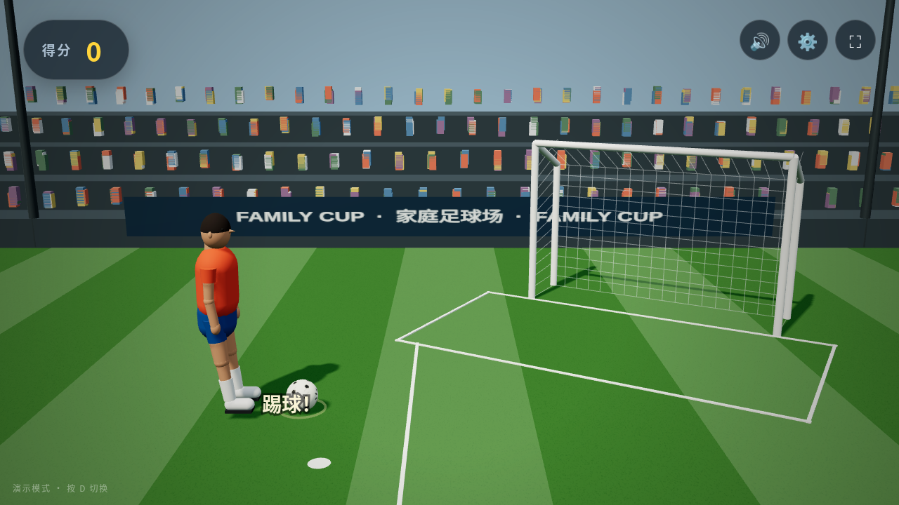
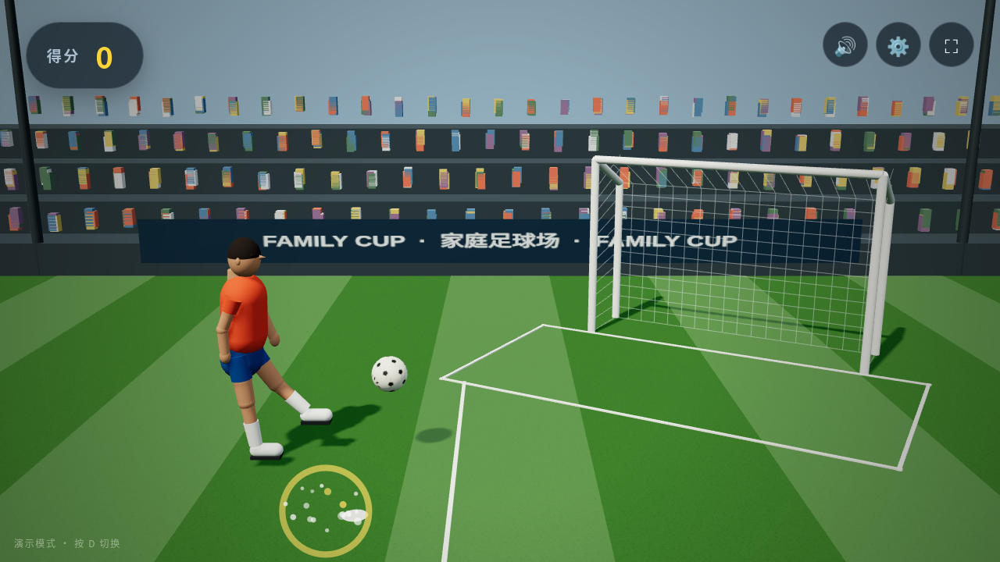
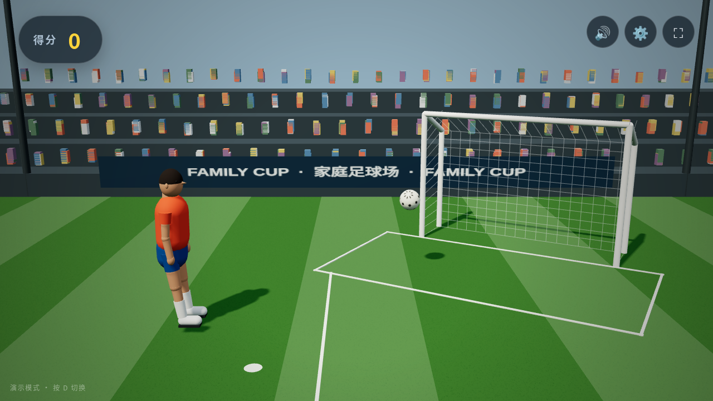
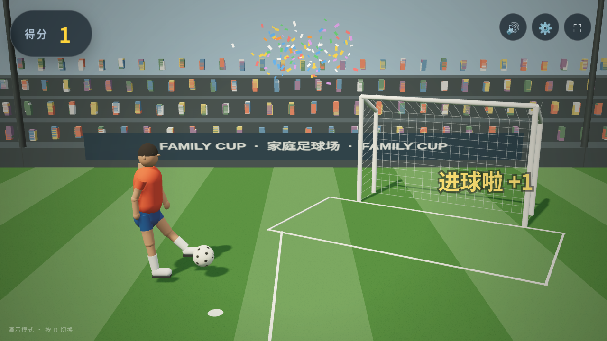
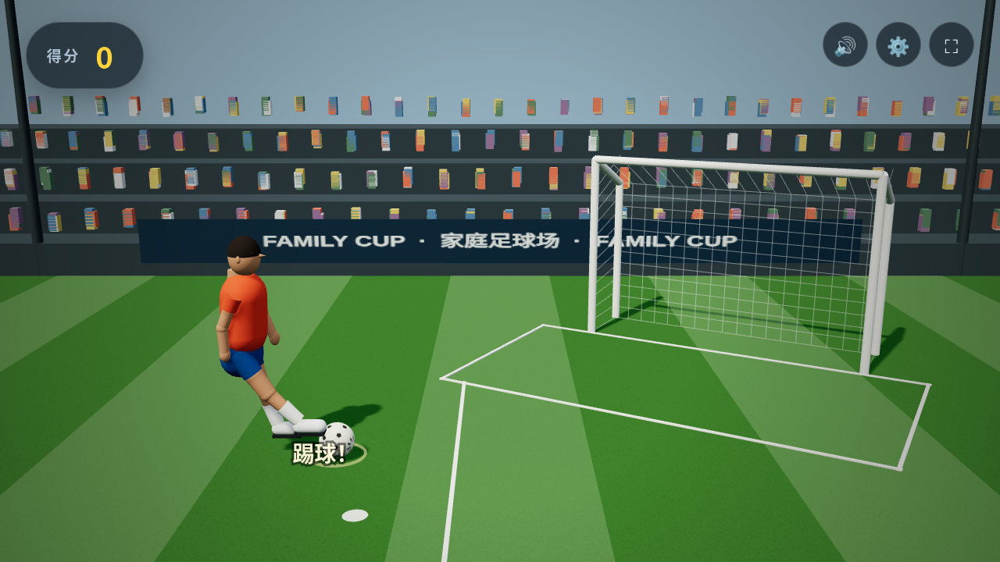
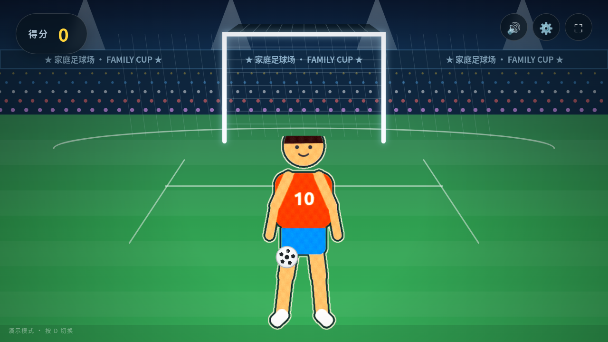

# 小小射手 · 体感足球

在电视/电脑前**用真脚踢屏幕里的足球**的儿童运动游戏。摄像头实时捕捉孩子的身体，默认用姿态驱动 **Three.js 三维球员**：人物在左并面向右侧球门，足球位于人物与球门之间。孩子仍面向电视自然抬脚，动作会映射成球员的侧向射门；进球有彩带、音效和语音鼓励。设置里还可切换正面的“风格化抠像”或“真人抠像”。

> 针对沙发前 2～3 米、全身入镜、电视大屏的客厅场景设计。浏览器打开即玩，摄像头视频和关键点不上传。

| 3D 待机：人 → 球 → 球门 | 3D 抬脚射门 |
| --- | --- |
|  |  |

| 足球飞向球门 | 进球庆祝 |
| --- | --- |
|  |  |

| 真实照片驱动 3D 球员 | 正面风格化抠像（可选） |
| --- | --- |
|  |  |

## 功能

- **实时姿态捕捉**：MediaPipe Pose Landmarker（33 个关键点）+ Selfie Segmenter，浏览器内 GPU/WASM 推理，模型和运行时均本地托管。
- **三维球场与人物**：Three.js/WebGL2 透视球场、斜向球门与立体球网、程序化三维球员、足球、看台、灯光与实时阴影；不是 Canvas 平面卡通。
- **正确的射门空间关系**：默认人物在左、面向右侧球门，足球在人物脚前并向球门飞行。
- **三种场上形象**（默认“3D 球员”）：
  - **3D 球员**：真实人体比例的程序化网格，由姿态关键点和射门状态驱动；
  - **风格化抠像**：正面可选模式，保留孩子轮廓，做色块、纸纹和描边；
  - **真人抠像**：正面可选模式，保留摄像头里的真人画面。
- **真踢真射**：按脚踝/脚跟/脚尖的加权质心与 140ms 速度窗口判定踢球，力度决定球速。
- **射门物理与计分**：沿用经过验证的 z/h 深度和高度模型，包含重力、弹跳、门柱/横梁、守门员、连击和 60 秒挑战。
- **三种画面来源**：真实摄像头 / 无摄像头演示 / 单张照片。
- **隐私**：摄像头画面、关键点和分割结果只在本机浏览器内处理。

## 快速开始

要求 Node.js ≥ 18（仅用于本地静态服务器）和支持 WebGL2 的现代浏览器。首次运行安装依赖：

```bash
npm install
npm start                      # 默认 http://127.0.0.1:8080
npm start -- --port=8099       # 指定端口
```

打开页面后点“开始游戏”，允许摄像头权限，站到离摄像头 2～3 米处让全身入镜。默认显示 **3D 球员**；右上角齿轮 →“场上形象”可切换“3D 球员 / 风格化抠像 / 真人抠像”，选择保存在本机浏览器中。

无摄像头时点“没有摄像头？看演示”，或直接访问：

- `http://127.0.0.1:8080/?demo=1` — 合成动作演示；
- `http://127.0.0.1:8080/?photo=/tests/fixtures/kid-kick.jpg` — 用照片跑真实模型；
- `http://127.0.0.1:8080/?autostart=1` — 跳过首页直接开摄像头；
- `http://127.0.0.1:8080/?debug=1` — 显示姿态与性能调试信息。

摄像头权限要求 **https 或 localhost**。首次加载会读取本地 WASM 运行时和约 6 MB 姿态模型，之后走浏览器缓存。Three.js 同样随包离线分发，不依赖 CDN。

## 怎么玩

1. 站在摄像头前 2～3 米，让头和脚都在画面里。
2. 足球会位于 3D 球员脚前；抬脚快速挥动即可射门，不必真的碰到屏幕。
3. 力度越大球速越快、弹道越高；轻推更容易进。
4. 连续进球累积连击奖励；60 秒挑战结束后显示结算。

键盘快捷键：`F` 全屏 · `M` 静音 · `Esc` 设置 · `D` 在摄像头与演示模式间切换。

## 技术方案

```text
摄像头 / 演示帧 / 照片
        │
        ▼
PoseTracker（MediaPipe Tasks Vision，GPU→CPU 回退）
  ├─ PoseLandmarker：33 关键点 + 世界坐标
  └─ ImageSegmenter：人像 mask（抠像模式使用）
        │
        ▼
buildPoseSample：镜像/letterbox 映射、脚部速度、身体中心和身高
        │
        ├─ 3D / 卡通：sideViewPose() → 固定左侧人物、向右摆腿
        └─ 正面抠像：保留原正面坐标
        │
        ▼
SoccerGame：踢球检测 + z/h 物理 + 门柱/守门员 + 计分
        │
        ▼
Renderer
  ├─ #stage3d：Three.js 球场、球员、守门员、足球、灯光和阴影
  └─ #stage：透明 Canvas 2D 特效、提示、彩带和调试层
```

3D 模式只替换画面呈现，不重写踢球判定和计分。`src/scene3d.js` 将游戏已有的 `drawX / z / h` 映射到世界坐标，透视相机自然产生远近缩放；人物脚部离地量和射门状态共同驱动摆腿。切换两种正面抠像时隐藏 WebGL 画布并恢复原正面布局，因此模式切换不改变游戏手感。

当前球员是**真实比例的程序化 3D 网格**，不是照片级人物、GLB 数字人或孩子本人的三维扫描。这样无需额外模型下载和骨骼资产，能在核显浏览器中直接运行；后续如要提升人物写实度，可单独替换为带骨骼蒙皮的授权模型，保留现有姿态和游戏接口。

### 目录结构

```text
index.html            页面结构、HUD、弹层、本地 Three.js import map
styles.css            全屏 UI 与双画布叠加
src/main.js           启动、来源/形象切换、设置、主循环
src/pose.js           MediaPipe 初始化、姿态采样和映射
src/game.js           踢球检测 + 物理 + 计分（无 DOM）
src/scene3d.js        Three.js 球场、球员、足球和 3D 动画
src/render.js         2D/3D 渲染编排、抠像、特效和 HUD
src/avatar.js         侧视姿态映射及原有关节处理
src/papercut.js       风格化抠像
src/synthetic.js      演示模式
src/audio.js          WebAudio 音效与中文语音
src/config.js         难度、物理常量、默认设置
models/               Pose Landmarker Lite、Selfie Segmenter
vendor/three/         Three.js 模块与许可证
vendor/mediapipe/     MediaPipe 运行时与 WASM
scripts/serve.mjs     本地静态服务器
tests/                游戏逻辑与 Playwright 端到端检查
docs/3d/              本机 3D 实机截图
```

## 本机验证

在 Intel Xeon E-2224G + **Intel UHD Graphics P630**（i915 / Mesa 25.2.8）桌面 Chrome 中，WebGL2 渲染器报告为 `ANGLE (Intel, Mesa Intel(R) UHD Graphics P630 (CFL GT2), OpenGL ES 3.2)`，不是 SwiftShader 软件渲染。

- 演示模式完成射门和进球，待机、抬腿、球路与进球后重生保持“人物 → 足球 → 球门”顺序。
- 120 帧实际采样平均间隔约 17.88ms、p95 约 22.13ms，约 **55.9 FPS**；这是本机当前场景实测，不是对所有设备的保证。
- 1280×720 场景约 64 次 draw call、13.6k 三角形；真实摄像头场景约 65 次 draw call、14.4k 三角形。
- 真实照片检测到双脚并使用 GPU 姿态推理；960×540 Y4M 假摄像头链路中姿态、mask 和 3D 球员正常。
- 风格化/真人抠像正确切回正面布局并隐藏 WebGL；900×600 窗口可继续游戏。
- 上述实机运行页面错误和控制台错误均为空，截图见 `docs/3d/`。

## 测试

```bash
npm test
python3 scripts/make_fakecam.py
python3 tests/e2e.py       # 先在 8099 端口启动服务
```

`tests/game.test.mjs` 覆盖游戏逻辑；`tests/e2e.py` 覆盖默认 WebGL2/3D、演示射门与进球、人物/球/球门空间顺序、强制射门脚部标记、三种形象切换、真实照片和假摄像头。本轮 **15/15 逻辑测试、32/32 浏览器检查通过**。测试脚本中的浏览器使用 SwiftShader，与本机 Intel 核显实机验证是两条独立链路。

## 调参

- 难度与脚速：`src/config.js` 的 `DIFFICULTY`。
- 踢球手感：`src/game.js` 的触球范围、速度窗口与冷却。
- 射门物理：`GRAVITY`、`GOAL_HEIGHT_M / GOAL_WIDTH_M`、`BALL_RADIUS_M`。
- 3D 世界：`src/scene3d.js` 的相机、灯光、人物比例、`WORLD_WIDTH / PLAYER_Z / GOAL_Z`。
- 检测频率：`src/pose.js` 按推理耗时自适应节流。

## 隐私与许可

- 摄像头画面、关键点与分割结果只存在于本机内存和画布，不发送视频请求。
- MediaPipe Tasks Vision 与模型为 Apache-2.0；Three.js 为 MIT，许可证随 `vendor/three/` 分发。
- 测试用小朋友照片由 AI 生成，非真实人物。

## 常见问题

**为什么默认看不到孩子本人？** 默认显示姿态驱动的 3D 球员。想看到孩子本人，请在设置中选择“风格化抠像”或“真人抠像”；这两种模式保留正面视角。

**需要独立显卡吗？** 不需要。本机 Intel P630 核显已验证可运行。设备过旧时仍可切换正面抠像模式，姿态模型也会在 GPU 不可用时回退 CPU。

**卡顿？** 关闭“显示骨架”，使用 720p 摄像头并确保浏览器开启硬件加速。应用会按推理耗时自动降低检测频率。

**球踢不动？** 确保全身入镜并快速抬脚；“萌新”难度的脚速要求最低。
